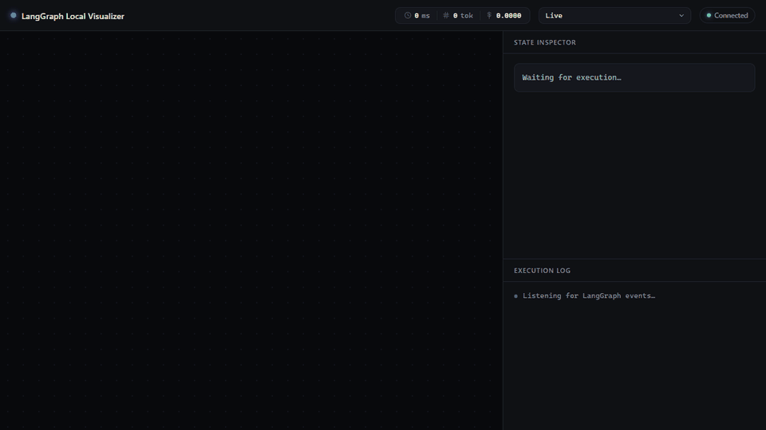
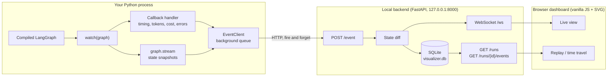

# LangGraph Local Visualizer

A local-first debugger for LangGraph agents: watch your graph execute live, step back through any past run, and see which node broke first.



*The demo shows a live run of `example_agent.py`, then stepping back through that run from history, then a run with a failure injected at `web_tool` (`RAISE_AT=web_tool`).*

## Why

When a LangGraph agent misbehaves, you want to know which node ran, in what order, what the state looked like before and after, and where things first went wrong. Hosted tracing tools like LangSmith answer that, but they need an account and send your traces to a cloud service. LangGraph Studio is not open source.

This project takes a narrower approach:

- **Local only.** Events go to a FastAPI server on `127.0.0.1` and are stored in a local SQLite file. Nothing is sent anywhere else, and there is no telemetry.
- **One-line integration.** Wrap your compiled graph with `watch(...)`. Your graph definition does not change.
- **Root-cause oriented.** State diffs per step, error highlighting with full traceback, and a "first anomaly" marker that points to the node where the run started to fail.

## Features

- Graph structure is extracted automatically from `compiled_graph.get_graph()`, including conditional edges and cycles.
- Live node highlighting over WebSocket as the agent runs; nodes in a cycle light up again on each visit.
- State inspector with the full state snapshot and a per-step diff (added, changed, removed keys), computed on the backend.
- Errors: the failing node turns red, the traceback is expandable, and the log marks the first anomaly.
- Per-node duration, token count and cost (cost uses a built-in price table for OpenAI models; unknown models show no cost).
- Every run is persisted to SQLite. Pick any past run from the selector and scrub through it with the timeline or the arrow keys.
- If the backend is not running, your agent still runs normally and prints a single warning.

## Architecture



- **Client** (`langgraph_visualizer/`): a LangChain `BaseCallbackHandler` for timing, tokens and errors, plus `graph.stream(stream_mode=["updates", "values"])` for reliable per-step state. Events are sent from a background thread so the agent is never blocked.
- **Backend** (`backend/`): FastAPI app that receives events, computes state diffs, persists runs and events to SQLite, and broadcasts to connected dashboards. It is the single source of truth.
- **Frontend** (`frontend/`): plain HTML, ES modules and SVG. No framework and no build step.

More detail in [docs/ARCHITECTURE.md](docs/ARCHITECTURE.md).

## Quick start

Requires Python 3.11+ and [uv](https://docs.astral.sh/uv/).

```bash
git clone https://github.com/z27833009/langgraph-visualizer.git
cd langgraph-visualizer

# terminal 1: start the backend (installs dependencies on first run)
uv run backend/main.py

# open http://127.0.0.1:8000/ in your browser

# terminal 2: run the example agent
uv run example_agent.py
```

The example agent is a small supervisor, RAG agent and web tool graph with a cycle. It runs without an API key by using a fake chat model. If `OPENAI_API_KEY` is set and `langchain-openai` is installed, it uses `gpt-4o-mini` instead.

To see error handling, inject a failure into a node:

```bash
RAISE_AT=web_tool uv run example_agent.py
```

Run the tests with:

```bash
uv run pytest
```

## Use it with your own graph

The package is not on PyPI yet. For now, copy the `langgraph_visualizer/` folder into your project (or add this repo to your `PYTHONPATH`) and make sure `langchain-core` and `requests` are installed.

Then wrap your compiled graph:

```python
from langgraph.graph import StateGraph, START, END
from langgraph_visualizer import watch

builder = StateGraph(MyState)
# ... add_node / add_edge as usual ...

graph = watch(builder.compile())   # the only change

result = graph.invoke({"question": "..."})
```

`watch()` returns a wrapper that supports `invoke`, `stream` (with `stream_mode="values"` or `"updates"`) and `ainvoke`. Each call becomes one run in the dashboard.

Options:

- `watch(graph, backend_url="http://host:port")` or the `LANGGRAPH_VISUALIZER_URL` environment variable to point at a different backend.
- `watch(graph, cost_table={...})` to supply your own per-model prices (USD per 1M input and output tokens).

## Roadmap

Done:

- [x] Automatic structure extraction and live highlighting through `watch()`
- [x] Error visualization, backend state diffs, first-anomaly marker
- [x] Per-node duration, tokens and cost, SQLite persistence, replay and time travel

Next:

- [ ] Publish as an installable package
- [ ] Side-by-side comparison of two runs (path, state, duration and cost per node)
- [ ] Subgraph and multi-agent views: expand and collapse subgraphs, follow delegation between agents
- [ ] Export a run as a single local file to share a replay without any hosting
- [ ] Turn a failed run into a regression test case that can run in CI
- [ ] Framework-agnostic ingest through OpenTelemetry spans, once the LangGraph path is solid
